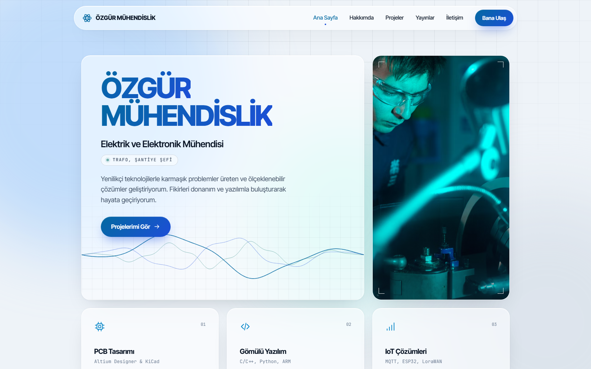

# Özgür Mühendislik

> Kurumsal Mühendislik Portfolyosu

Elektrik-elektronik mühendisleri ve freelance çalışan profesyoneller için modern, güven veren ve kurumsal imaja uygun web portfolyosu.

**Canlı demo:** https://serkangudur.com/projeler/ozgur-muhendislik



## Öne çıkanlar

- Osiloskop dalgası animasyonu
- İmleci izleyen ışık ve 3B eğim efektleri
- Zaman çizelgesi bölümü
- Erişilebilir detay penceresi ve mobil menü
- Azaltılmış hareket tercihine uyum

## Teknolojiler

`HTML5` · `CSS3` · `JavaScript` · `GSAP` · `Lenis`

## Yerelde çalıştırma

Derleme adımı yoktur; herhangi bir statik sunucu yeterlidir:

```bash
npx serve .
```

---

Bu proje [serkangudur.com](https://serkangudur.com) portfolyosunun bir parçasıdır. Sayfadaki iletişim bilgileri örnek amaçlıdır.
